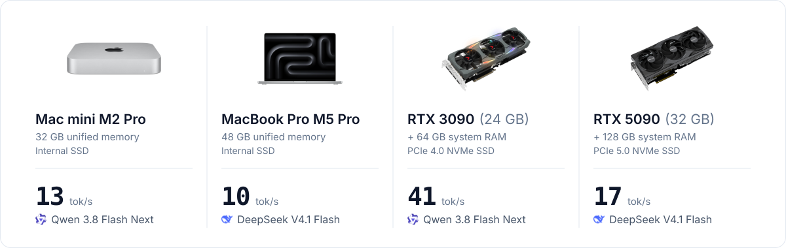

<p align="center">
  <picture>
    <source media="(prefers-color-scheme: dark)" srcset="assets/brand/icon-dark.svg">
    <source media="(prefers-color-scheme: light)" srcset="assets/brand/icon-light.svg">
    
  </picture>
</p>

<h1 align="center">Magnitude</h1>

<p align="center"><strong>Run powerful open models on the hardware you already own</strong></p>

<p align="center">
  <a href="https://magnitude.dev/download"></a>
  <a href="https://docs.magnitude.dev"></a>
  <a href="https://discord.gg/EHt48pPWdC"></a>
  <a href="https://x.com/usemagnitude"></a>
  <a href="https://github.com/magnitudedev/magnitude/stargazers"></a>
</p>

Magnitude is an open source inference engine that spreads models across your GPU, RAM, and SSD so they run on everyday Macs and PCs. It works on Apple Silicon, NVIDIA, AMD, Intel, or just a CPU. One click connects it to the agent you already use (Pi, OpenCode, Hermes, Codex, and more).

⭐ Help us reach more developers and grow the Magnitude community. Star this repo!

## Get started

Download the installer:

- **macOS:** [Apple silicon](https://magnitude.dev/api/installer?os=darwin&arch=arm64&package=dmg) · [Intel](https://magnitude.dev/api/installer?os=darwin&arch=x64&package=dmg)
- **Windows:** [x64](https://magnitude.dev/api/installer?os=windows&arch=x64&package=windows-exe)
- **Linux x64:** [.deb](https://magnitude.dev/api/installer?os=linux&arch=x64&package=deb) · [.rpm](https://magnitude.dev/api/installer?os=linux&arch=x64&package=rpm) · [.pkg.tar.zst](https://magnitude.dev/api/installer?os=linux&arch=x64&package=pacman)
- **Linux ARM64:** [.deb](https://magnitude.dev/api/installer?os=linux&arch=arm64&package=deb) · [.rpm](https://magnitude.dev/api/installer?os=linux&arch=arm64&package=rpm)

Setting up a server? Install the CLI only:

```sh
curl -fsSL https://magnitude.dev/install.sh | sh     # macOS / Linux
irm https://magnitude.dev/install.ps1 | iex          # Windows PowerShell
```

For more info, see [CLI only](https://docs.magnitude.dev/installation/cli-only). For Docker container installs, see [Docker](https://docs.magnitude.dev/installation/docker).

## Why Magnitude?

- **Use your whole machine:** streams experts from RAM and SSD, not just your GPU
- **Tuned to your chip:** optimizes kernels per model, over 2x faster than Ollama
- **Works out of the box:** configures itself for your machine, no flags or manual tuning
- **Built for concurrent agents:** flexing KV memory and shared prefix caches
- **Works with your agent:** one click connects Pi, OpenCode, Hermes, Codex, and more
- **Free, private, open source:** no token costs, nothing leaves your machine, Apache 2.0

## How it runs on everyday hardware

<picture>
  <source media="(prefers-color-scheme: dark)" srcset="assets/benchmarks/machines-dark.svg">
  
</picture>

[View full benchmarks →](https://magnitude.dev/benchmarks)

## FAQ

### How does it run models bigger than my memory?

Most large open models today are ultra sparse MoEs: they are split into hundreds of small parts called experts, and only ~5% activate for each token. Magnitude spreads the model into tiers (GPU VRAM holds the shared layers and most used experts, system RAM holds the next tier of frequently used experts, and your NVMe SSD holds the rest). On every token, Magnitude predicts and prefetches upcoming experts up from SSD to RAM to VRAM before the GPU needs them.

### Why is it faster than other local engines?

Other engines ship one-size-fits-all kernels, because tuning each model for each chip by hand would take forever. Magnitude tunes kernels automatically on your actual chip when you download a model, pairs each model with its best speculative decoding drafter, and predicts and prefetches streamed experts off RAM and SSD ahead of time. [See the full benchmarks against Ollama.](https://magnitude.dev/benchmarks#ollama)

### What hardware do I need?

Any Apple Silicon, NVIDIA, AMD, or Intel GPU, or nothing but a CPU, on macOS, Linux, or Windows (desktop app, headless CLI, or Docker). VRAM needs to fit at least the active experts for a model; beyond that, the more experts you can cache in VRAM and RAM the faster it runs, and a faster NVMe SSD (like PCIe 5.0) speeds up anything that spills to disk. Magnitude profiles your machine and recommends the best models before you download anything.

### Which models can I run?

Any GGUF model from Hugging Face in a supported family, including fine-tunes and other people's quants. We write optimized kernels for each of the most popular open-weight families, including sparse MoE models that stream from RAM and SSD. See the families and the models we recommend at [magnitude.dev/models](https://magnitude.dev/models).

### Which agents work with it?

One click connects Pi, OpenCode, Hermes, OpenClaw, Codex, Claude Code, Oh My Pi, and Cline. Anything else works through the OpenAI-compatible API.

### Will streaming wear out my SSD or slow down my computer?

No. Streaming model weights from your SSD is strictly read-only, so it causes zero flash wear. Magnitude also uses direct uncached reads instead of OS disk swap, and dynamically shrinks KV memory when sessions go idle so your computer stays responsive.

### Is it free and private?

Yes. Magnitude is 100% free and open source under Apache 2.0. Prompts, files, and models stay on your machine, with no token costs, API keys, or internet connection needed once a model is downloaded.
