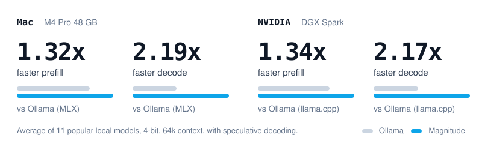

  <picture>
    <source media="(prefers-color-scheme: dark)" srcset="assets/brand/icon-dark.svg">
    <source media="(prefers-color-scheme: light)" srcset="assets/brand/icon-light.svg">
    
  </picture>

<h1 align="center">Magnitude</h1>

<strong>Run open models as fast as your hardware allows</strong>

  
  
  
  
  

Magnitude is an open source inference engine that optimizes each model for your exact hardware. When you download a model, Magnitude spends up to a minute tuning its kernels to find the fastest configuration for your hardware. On the same hardware, it's 2x faster than Ollama. It works on Apple Silicon, NVIDIA, AMD, or just a CPU. One click connects it to the agent you already use (Pi, OpenCode, Hermes, Codex, and more).

**[Download Magnitude for macOS, Windows, or Linux](https://magnitude.dev/download)**

⭐ Help us reach more developers and grow the Magnitude community. Star this repo!

https://github.com/user-attachments/assets/983328c8-93e8-4360-bfef-11e93ff76035

## Get started

1. [Download Magnitude](https://magnitude.dev/download), install it, and open the app.
2. Choose a recommended model in **Discover** and download it.
3. Connect your agent in **Connections** and start using it.

The desktop app includes the `magnitude` CLI. No separate installation is needed.

## Why Magnitude?

- **2x faster than Ollama:** on average across popular local models, on Mac and NVIDIA
- **Tuned on your hardware:** kernels are tuned for each model when you download it
- **Best drafter built in:** each model ships with the fastest speculative decoding drafter
- **Memory that flexes:** quantized KV halves memory per agent, freed when agents stop
- **Fast concurrent sessions:** sessions share prefix caches to prevent slowdown
- **Works with your agent:** one click to connect Pi, OpenCode, Hermes, Codex, and more
- **Free, private, open source:** no token costs, nothing leaves your machine, Apache 2.0

## 2x faster than Ollama

<picture>
  <source media="(prefers-color-scheme: dark)" srcset="assets/benchmarks/ollama-dark.svg">
  
</picture>

## FAQ

### What is Magnitude?

An open source inference engine that optimizes each model for your exact hardware. It ships as a desktop app that runs open models and connects them to the agent you already use.

### How is it faster than llama.cpp, Ollama, or LM Studio?

They ship one-size-fits-all kernels, because tuning each model for each chip by hand would take forever. Magnitude tunes them automatically. When you download a model, it spends up to a minute on your actual chip trying different ways to split up the math (how many GPU threads team up, how big a chunk each one takes, how far ahead to load data) and keeps the fastest combination that doesn't change the model's output. [See the benchmarks against Ollama.](#2x-faster-than-ollama)

### What hardware do I need?

Any Apple Silicon, NVIDIA, or AMD GPU, or nothing but a CPU. There is no fixed minimum. Smaller machines run smaller models, and more memory lets you run larger ones.

### What operating systems does it support?

macOS, Linux, and Windows.

### Which models does it support?

See the full list at [magnitude.dev/models](https://magnitude.dev/models). We write optimized kernels for the most popular open-weight families, which is how we beat generalist engines.

### Which agents work with it?

One click connects Pi, OpenCode, Hermes, OpenClaw, Codex, Claude Code, Oh My Pi, and Cline. Anything else works through the OpenAI-compatible API.

### Is it private?

Yes. Prompts, files, and models stay on your machine. No internet needed once a model is downloaded.
