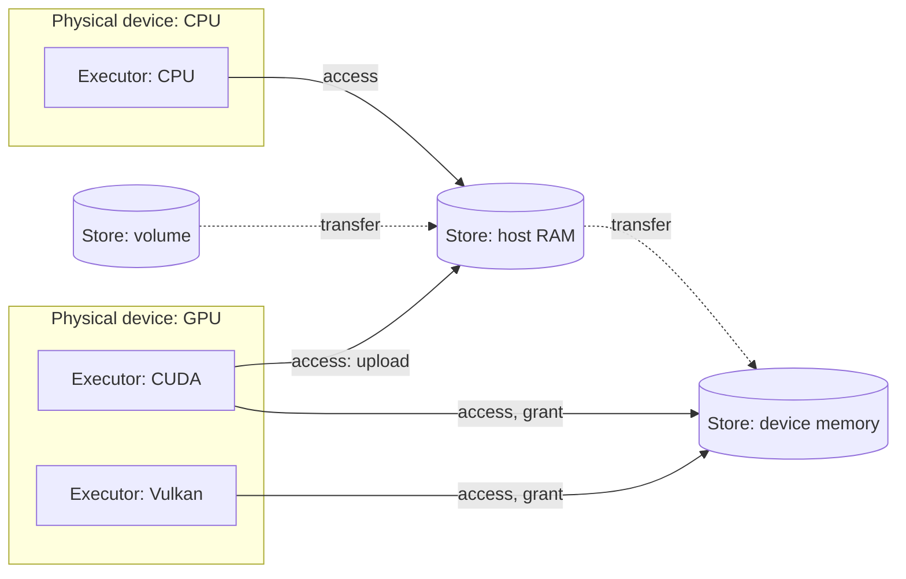

# Device topology

**One model of the machine: where computation runs, where bytes live, and what each executor may
place where.** `seismic-topology` discovers it from standard interfaces; it measures nothing, and
every value in it is one an interface reports. How fast work runs on it is measured apart from it
(`seismic-measure`, below).

## The graph

| Node or edge | What it is |
| --- | --- |
| Physical device | One piece of hardware, identified by the identity its drivers share |
| Executor | One backend's handle on a physical device (CPU, Metal, CUDA, Vulkan); what runs kernels and what selection names |
| Store | A place bytes live, with one ledger: **host RAM** (memory the OS manages), **device memory** (memory the OS does not manage, owned by one physical device), **volume** (a filesystem) |
| Access path | An executor reading and writing a store directly, under the **grant** its driver gives this process there |
| Transfer path | Bytes moved between stores by an executor's copy mechanism: a volume into RAM, RAM into device memory, one GPU to another |
| Placement | For each storage kind an executor allocates, the ordered access paths its backend allocates from |

**Memory the OS manages is host RAM, whoever uses it.** A GPU whose memory is the host's (Apple
silicon, GB10, integrated GPUs) has access paths into host RAM under its driver's grant, so its
charges and the CPU's are one sum. Memory the OS does not manage, a discrete GPU's or one an
integrated GPU's adapter reports as dedicated, is a device memory store; such a GPU places there
first and then in host RAM. Whose memory a GPU's is, discovery decides once per physical device
from all its backends' reports (Vulkan's device type, CUDA's integrated or NUMA-node memory,
Metal's unified memory); every executor of the device places by that one decision, and reports that
disagree make its executors unavailable.

An access path also names its route: the memory its executor allocates along it. A discrete Vulkan
heap is a route of its own. An integrated Vulkan adapter's dedicated and shared grants share one
route, the same memory, while their charges and remaining budgets are partitioned in placement
order. The remaining grants sum to at most the driver's remaining budget.

Stable selectors name native executors across revisions. A GPU's physical identity is its device
UUID, which its CUDA and Vulkan views report alike and which survives a reboot; the OS adapter LUID,
new each boot under WDDM, only matches the dedicated memory the OS reports to the adapter.

**Process limits are grants too.** A cgroup, address-space or job limit bounds every path into host
RAM.

**Revisions are immutable.** A refresh that finds a different machine builds a new revision; old
identifiers become stale and are never renumbered.

The normalized graph uses stable selectors and store identities, independent of revision and
enumeration order. Hardware fingerprints exclude timestamped status.

## Reported values

| Layer | What | How | Lives |
| --- | --- | --- | --- |
| Structure | nodes, paths, identities, executor kinds, whose memory each device's is, capacities, caches, grants, limits | reported by APIs at discovery | one topology revision |
| Status | each store's headroom, what is left of each grant | reported by APIs in a sample | one timestamped sample |

Every value is a **reported value**, carrying the API that reported it. Nothing is assumed.

**APIs report structure and limits.** Discovery reads only standard interfaces (Vulkan, CUDA, Metal,
the OS's memory, filesystem and adapter interfaces) and branches only on what they report, never on
a vendor or model. A placement is what the backend actually allocates from, so the grant reported
and the memory used agree. Where no interface reports a value, the topology takes the conservative
reading: memory it cannot place outside the OS counts as host RAM. A device's cache (the CPU's
last-level caches, a CUDA device's L2) is reported where its API reports it; a cache the OS reports
but that cannot be read fails discovery.

**Every executor has an identity**: its physical device's (for a CPU, the reported processor, ISA,
cache and memory configuration, not merely the OS build), its backend and its driver. It names the
hardware and software a measurement was taken on, and changes when any of them does.

## Measuring work

How fast work runs is measured, never looked up: a peak an API reports is not an achievable rate,
and most report none. `seismic-measure` times work and depends on nothing else in Seismic; the
runtime gives it two kinds of work, a formed kernel's calls over a rotation of argument sets and a
sealed graph's runs (timed on the device from the submission's trace, or on the host waited or
queued).

- **One session.** A sample is one submission of a calibrated number of passes queued behind its
  lead, so the device comes to it from the same work. A work measured alone is led by its previous
  sample; only its first sample, and one following a reading of the stopping rule, are behind an
  untimed one-pass lead. Tuning's comparisons and every measured point take their times this way.
- **The sustained clock.** A GPU is raised to its sustained clock, gauged with the caller's own work,
  once per physical device for all its executors, and raised again before every later measurement.
  A CPU's clock is not raised: raised and unraised it reads within the tolerance.
- **One stopping rule.** A time is sampled until an anytime-valid confidence interval for its
  median lies within 10% of it, at the caller's error rate: a point stops when its median is
  resolved. 10% is the precision the engine's estimate can
  use: its own error is about ±15% typical, the spread across models of its composition ratio in
  recorded tuning traces and decodes on M4 Pro, RTX 3090 and GB10, so finer precision is discarded.
- **Records.** A measured point is kept under a key of what it is a function of: the executor's
  identity, the identities of the kernels it runs (computed without a device, from their
  declarations, sources, bindings, static values and backend, with CUDA's NVRTC release), their
  configuration and the point's own values. One function writes records: it loads a point's record,
  asks the host whether to attempt it, forms its work, times it, and records its timing or, when the
  host skips it or its work can never be formed under its key, why it is unobtainable; work that
  cannot be formed now (its operands' allocation failed) and a failed timing leave no record, so a
  later request attempts the point again. Records are read bounded and
  written atomically, through a store the host implements beside the kernel cache.

Which points are measured, and what they price, is the engine's: nothing is measured until
something prices it. Measuring opens executors and runs kernels, so nothing measures implicitly.

## API

| Call | Returns |
| --- | --- |
| `topology()` | the reported structure of the current revision |
| `refresh()` | the revision after discovering again: the same one when the machine reads the same, a new one when it does not |
| `sample(topology)` | a timestamped status sample of a revision's stores and grants |
| `host_status()` | one reading of host RAM alone, as a sample reads it |
| `executor_identity(executor)` | the identity measurements of the executor are keyed by |
| `volume_available(path)` | the free space of one path's volume, as a sample reads it |

The topology describes the machine. It knows nothing of models, loads or reserves.

## Ownership

| Owner | Responsibility |
| --- | --- |
| `seismic-topology` | What the machine is, end to end: the graph, discovery through the backend crates and the OS, status samples, and executor identities |
| `seismic-measure` | Timing work: the session, the sustained clock, the statistics and stopping rule, deadlines, and the records of measured points |
| Seismic runtime | Opening executors by identity, allocation and ledgers, the measurable work (kernel calls, graph runs), kernel identities, and tuning |
| Engine | Interpreting the topology for inference, in one place per use (below), and which points to measure |

`seismic-topology` and `seismic-measure` are internal to Seismic and published through the
`seismic` crate, like every Seismic crate; consumers, including anything that only needs to know the
machine, depend on `seismic`. Inside Seismic, `seismic-runtime` depends on `seismic-topology`
(which depends on the backend crates) and on `seismic-measure` (which depends on no Seismic crate).

## Consumption

The engine reads the topology in two functions, each with one owner, and the rest of the engine
goes through them rather than interpreting grants, stores or rates itself:
- **Fit** (memory policy): whether a demand fits, from the topology, a sample and the engine's
  reserves. Admission, the device heap, first-load tuning, assessment, the hardware view and
  downloads use it.
- **Cost** (estimates): how long work takes, from the topology and the executor's measured points.
  Speed estimates use it, and selection will.

## What it enables

- Correct capacity on every unified-memory device, from its driver's grants.
- Host RAM accounted once across every device and model in the process.
- Speed estimates from work measured on the executor that runs it.
- Choosing among physical devices by fit and cost; loads spanning executors; a discrete GPU's data
  in host RAM; streaming from a volume. The graph expresses these; using them is engine work on top.
