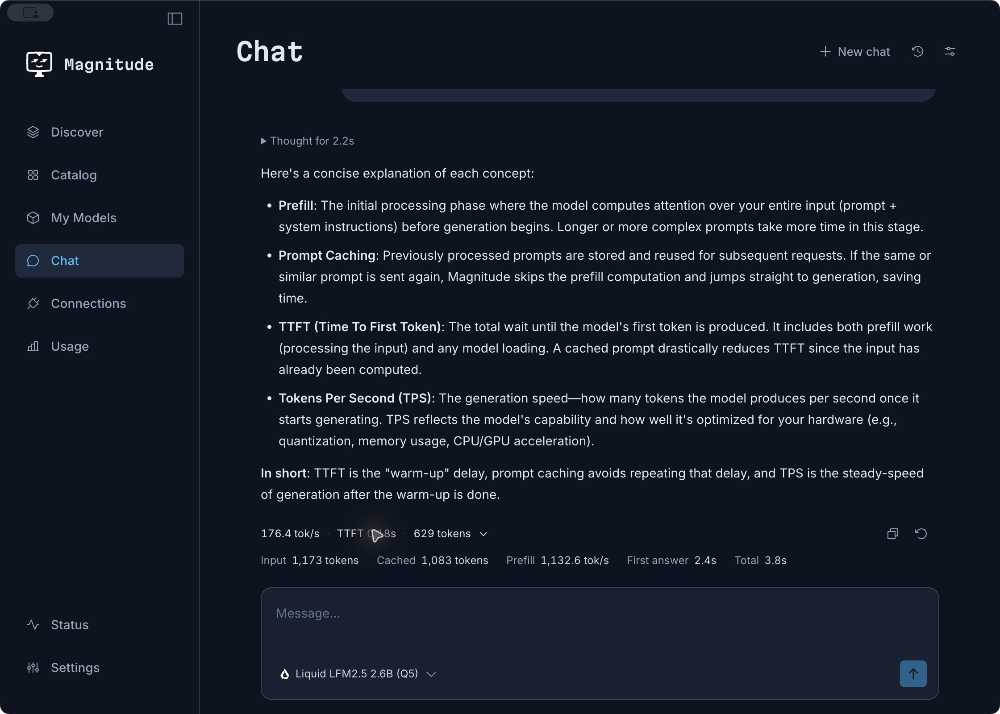
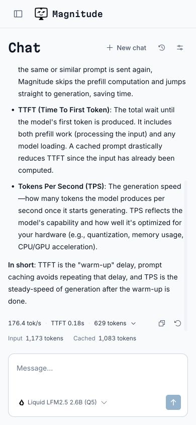

# Native Chat implementation and local verification

Implemented on `codex/chat`, starting from `8f4cee7cf`. The installed production app was left alone. All inference checks used the separate development service on port 11101 and its `.magnitude-desktop-dev` data folder. No cloud machines were used.

The development web app is running at [http://127.0.0.1:5189/chat](http://127.0.0.1:5189/chat). The native development app runs as Electron, with its renderer at localhost:5173.

## Delivered behavior

- Native Chat navigation and the agreed composer, small model logos, Levels icon, supported reasoning choices, and settings drawer. No duplicate model controls, assistant name/avatar, preview controls, Chat theme toggle, or response-details panel.
- Streaming responses and reasoning, real engine token counts and throughput, end-to-end TTFT, first-answer timing, inline metric expansion, Copy, Retry, and Stop.
- Structured activity immediately above the composer, with a spinner, subtle shimmer, compact measured percentages, and labeled metrics separated only between columns. Unavailable byte speeds, optimization counts, and estimates are omitted.
- SQLite history on the inference host, titles from the first prompt, pagination, rename/delete, retained attempts, atomic admission, periodic checkpoints, restart recovery, and idempotent commands.
- Service-owned generation continues across navigation and disconnected viewers. Cumulative updates are coalesced for slow viewers without repeatedly transmitting the transcript or losing admission snapshots.
- Drafts and next-request settings survive navigation. Retry preserves an unsent next-message draft. Failed generations restore their submitted text when the next draft is empty. New chat retains the current model and settings.
- Every request includes the approved bundled [Magnitude background](../../../../packages/acn/src/chat/magnitude-info.md), custom instructions, and actual service-host setup facts. The exact request and information version are retained internally. No shell, filesystem, browser, or agent tools are supplied.

## Automated checks

| Package | Final result |
| --- | --- |
| Web | 322 passed |
| ACN: Chat and adjacent startup/catalog/usage/activity tests | 51 passed |
| ACN protocol | 87 passed |
| Storage | 85 passed |
| SDK | 43 passed |
| Client common | 121 passed; 1 pre-existing failure |

709 checks passed across these runs. Commands used `bunx --bun vitest run`, with the ACN run targeted to the affected domains. Targeted TypeScript checks passed for ACN, storage, client common, web, and desktop. Web and Electron production builds passed. Release preparation allocated RPC 10, and the official release verification passed.

The unchanged client-common failure is `src/utils/local-model-radar.test.ts:41`: the test expects DFlash speculation `0.5`, while the existing implementation returns `0.4`. It was reproduced using copies of the source and test extracted from the starting Git revision. Neither file was changed for Chat.

Chat regression coverage includes duplicate commands across service reconstruction, competing sends, immediate Stop, all preparation phases, paused progress, slow viewers, reasoning/text separation, empty chunks and TTFT, truncated output, transport failure with partial output, immutable in-flight settings, retry history, 20-turn conversations, checkpoint persistence, corrupt/newer databases, terminal write failure and recovery, pagination/deletion, and shutdown/restart recovery. UI checks cover Markdown safety, missing measurements, supported reasoning levels, draft retention, IME and Shift-Enter, and escaped stop sequences.

## Real local inference

Hardware: Apple M4 Max, 64 GiB unified memory, Metal.

| Run | Result |
| --- | --- |
| Liquid LFM2.5 2.6B Q5, mandatory reasoning | 24-message conversation; sampling changes, Retry, Stop, idempotency and metrics passed. Cold admission-to-first-token included optimization/loading: 72.1s. |
| MiniCPM5 1B Q4, thinking disabled | 24-message conversation with complete responses; settings, history, Retry and Stop passed. |
| MiniCPM5 after restarting the final dev service | Repeated 24-message flow with cumulative stream folding, settings, Retry and Stop passed in 14s. |
| Oversized context | A 900,000-character message produced the expected engine error: `151131 tokens ... 131072-token context`. The full admitted input remained stored. Passed in 8s. |

These were functional checks, not comparative model benchmarks. They were run through `mrig script --backend metal --host local`, with purpose and duration estimates. Reusable live-check sources are [local-chat.ts](local-chat.ts) and [context-limit.ts](context-limit.ts).

Native model metadata correctly exposes MiniCPM5's `none` as **Off**, and `high` as **High**. The LFM model's mandatory single effort hides the redundant selector. Four-level metadata is also covered by deterministic tests; unsupported Low/Medium choices are never invented.

## UI review

Checked the actual Electron dev app and the actual web app, including light/dark appearance, a 390px narrow viewport, upward menus, settings overlay and focus, history restoration after restart, metric expansion, multiline input, navigation during generation, model changes during generation, Retry with an unsent draft, and immediate Stop.

The review found and corrected the initial Stop race, a narrow drawer translation error, progress updates waiting for another chunk, retry erasing a draft, and decoded inference errors losing their useful message. The final screenshots show actual saved responses and engine metrics.

